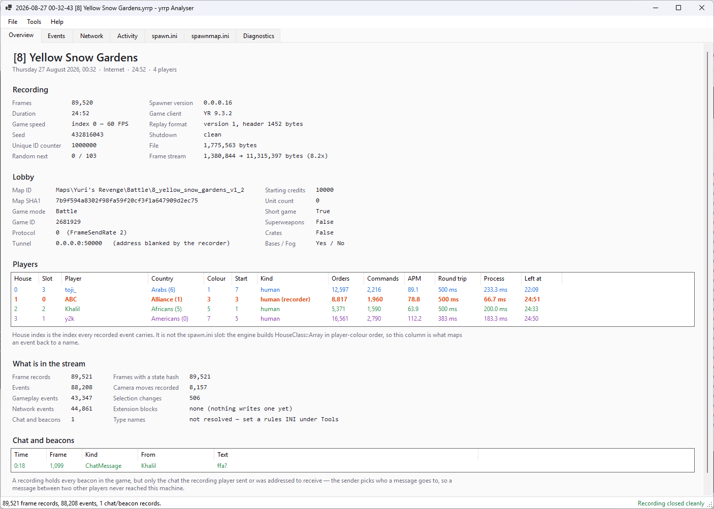
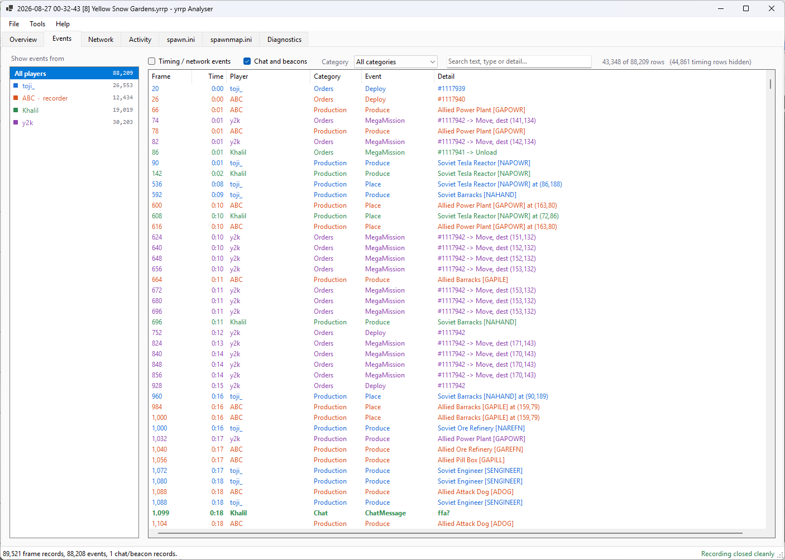
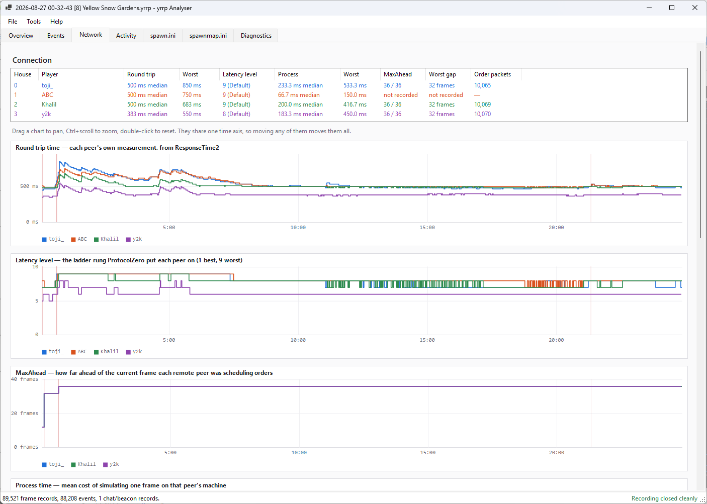
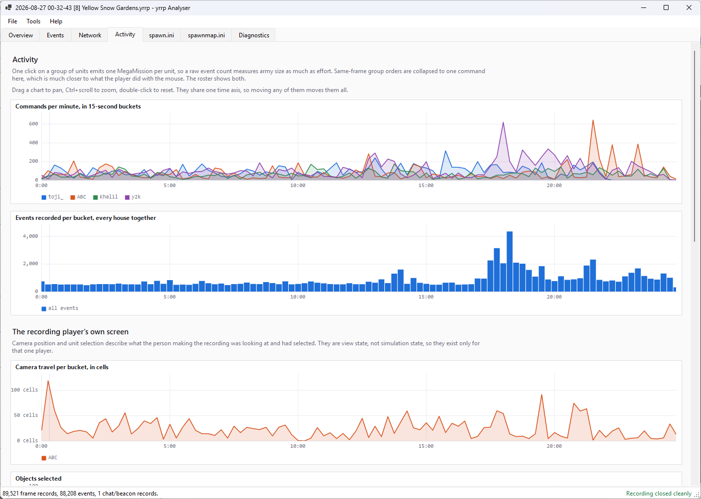
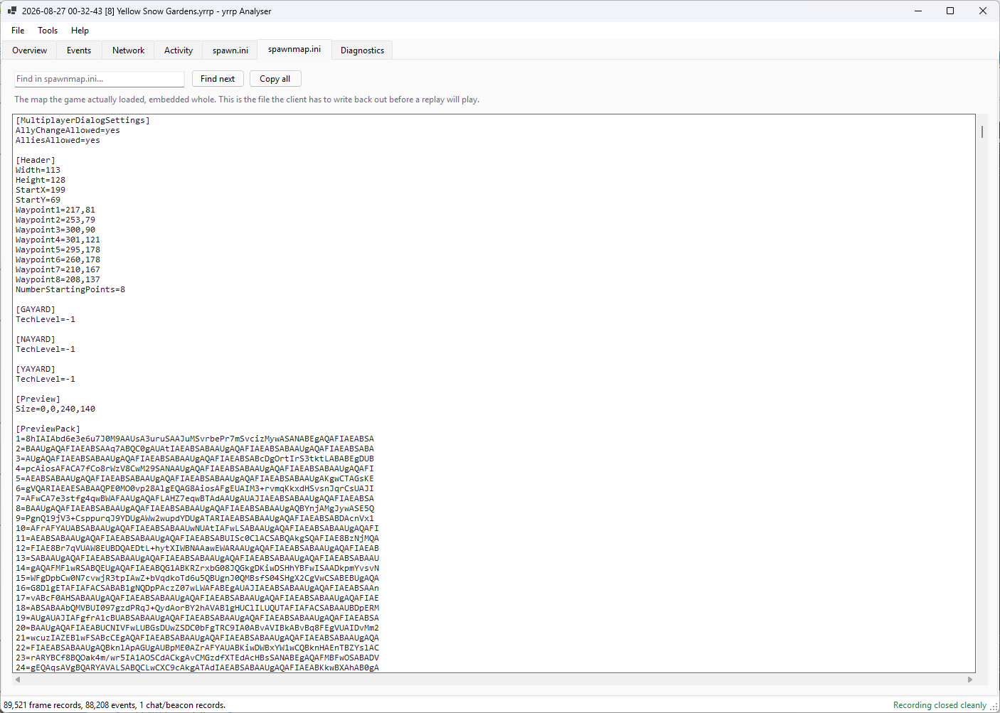
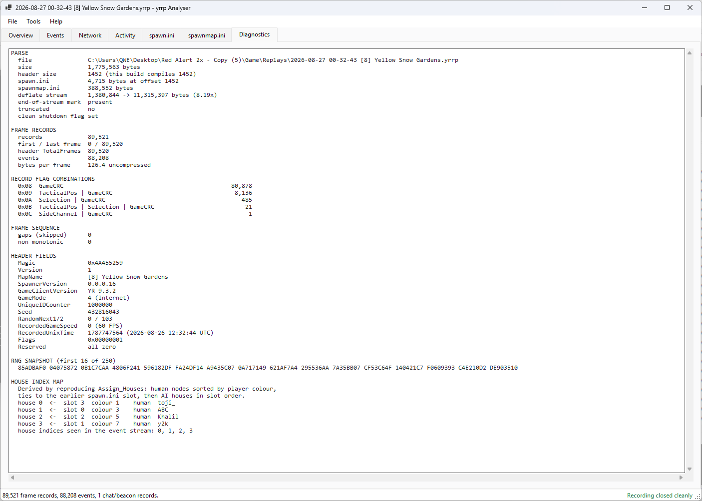

# yrrp Analyser

Reads `.yrrp` replays — the recording format written by the CnCNet [yrpp-spawner](https://github.com/CnCNet/yrpp-spawner)
for Red Alert 2: Yuri's Revenge. It does not play them; it opens one and shows what is actually
inside: who played, what they did, how their connections behaved, and — given both peers'
recordings of one match — the exact frame a desync started on, from the per-frame state hash, and
whether the two copies are the same unedited game, from their canonical seals.

```
dotnet build
dotnet run --project src/YrrpAnalyser.App -- "path\to\replay.yrrp"
```

.NET 8, no external dependencies. `src/YrrpAnalyser.Core` is the parser and analysis on its own;
`src/YrrpAnalyser.Cli` is a headless `yrrp` command for batch work (`--scan` a folder, `--compare`
two recordings, `--export` every CSV/JSON, `--verify` a file's seals and chat, `--compare-seals` two
copies of one game).

## Overview

Header, lobby and roster. House index is what every recorded event carries, and it is not the
spawn.ini slot — the engine orders `HouseClass::Array` by player colour, which the analyser
reproduces.



## Teams

Who played with whom - the lobby's alliances, falling back to those held at the end of the game - and
each team's result, players, totals and a side-by-side table; how each team's income, spending, army,
production and kills split between its players; units and buildings destroyed team against team; and
team timelines for the win estimate, army, income, money, base, kills and losses.

The **win estimate** is the Replay Insights advantage index - army value, the last minute's income,
base value and usable cash, relative to the other teams still playing - sharpened so its percentages
match how often the favourite actually won across 20 recorded games. It only ever looks backwards, so
it never knows the result early.

## Events

Every event, chat message and beacon on one timeline, with payloads decoded. Pick a player on the
left; timing and network events are hidden by default.

Production events carry a position in the game's type array rather than a name, so point
`Tools > Set rules INIs` at an extracted `rulesmd.ini` and they read as `Soviet Engineer
[SENGINEER]` instead of `InfantryType#27`.



## Network

Per-player connection response, requested latency level, MaxAhead, mean process time and
FRAMEINFO spacing share one game-time axis. Drag any chart to pan and the rest follow,
Ctrl+scroll to zoom, double-click the plot to reset. Click a legend name to hide or show
that series in its chart, Shift+click to isolate it, and **Show all** to restore every series.
Legends wrap to keep every player accessible. Line charts use unfilled strokes; power
usage uses a dashed stroke in the same player colour. Large FRAMEINFO gaps are marked in red.

Process time is already milliseconds per frame, averaged over normally 128 frames. It measures
main-loop work including input, rendering and logic, ending before the network queue and pacing
wait. A raw value of 12 means 12 ms/frame, not the 200 ms earlier analyser builds displayed.

ResponseTime2 is the peer's worst smoothed connection response, with its extra tick removed;
the binary uses 16 ms ticks. It includes ACK servicing and possible retry delays. The legacy
ResponseTime event sets MaxAhead and is not an RTT measurement.

See [the binary audit](docs/network-event-audit.md) for addresses, formulas, and limitations.

Two caveats, both in the format rather than the tool: the recording player has no MaxAhead line,
because its own `FRAMEINFO` goes straight into the outgoing packet and never reaches the event
queue; and dropped packets and retransmissions are counted below the event queue and are not in a
replay at all. FRAMEINFO gaps are simulation-frame intervals; without packet arrival timestamps,
they cannot establish whether a real-time stall occurred or how long it lasted.



## Activity

Commands per minute, event density, the recording player's camera and selection, build order, and
an event breakdown by house.



## spawn.ini and spawnmap.ini

Both embedded files, searchable and exportable. The recorder embeds them verbatim; any address
sanitization is the client's responsibility.



## Diagnostics

Parse results, record-flag histogram, frame-sequence checks, every header field, the game-speed
segments, and the derived house-index map.



## Keeping up with the format

`src/YrrpAnalyser.Core/ReplayFormat.cs` mirrors the spawner's `ReplayFormat.h` by hand, the same
way the CnCNet client's `YRReplayGame.cs` does, and `Canonical.cs` mirrors `ReplayCanonical.cpp`.
There is no compile-time link, so a format change has to be made here too — a size or offset drift
is silent, not an error, and a canonical-form drift makes every seal disagree. The spawner's
`docs/replay-format.md` is the reference.

The reader matches the 1096-byte header and the tagged frame blocks of spawner commit `3bbcf71`
on `yr-build`. Earlier recordings are not supported.

`yrrp --verify` checks a file against itself: every seal against the canonical chain recomputed from
its contents, and every chat line against the fingerprints in its events. `yrrp --compare-seals`
checks two copies of one game interval by interval.

Run the Windows chart and list-view regression checks with:

```
dotnet run --project tests/YrrpAnalyser.AppTests
```

These exercise legend visibility and wrapping, zoomed line rendering, drag capture, and
column sizing against both headers and cells, including empty and virtual lists.
